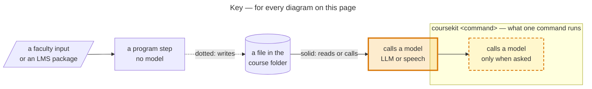
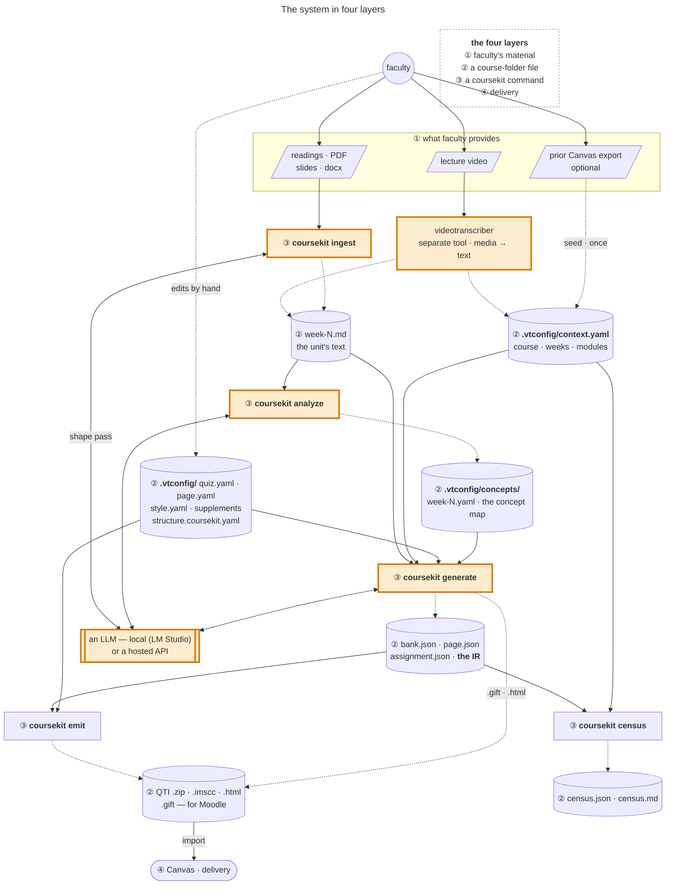
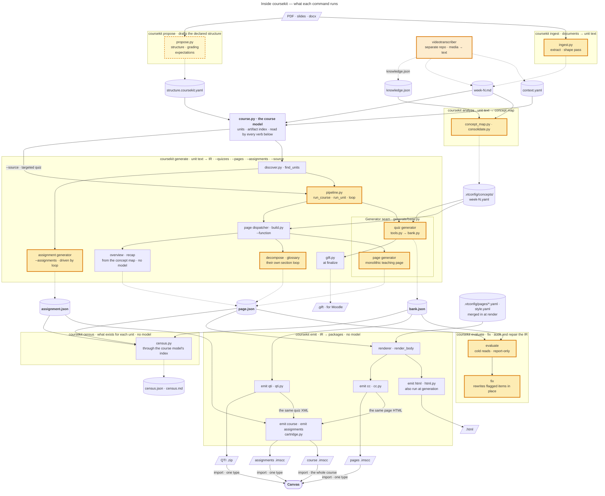
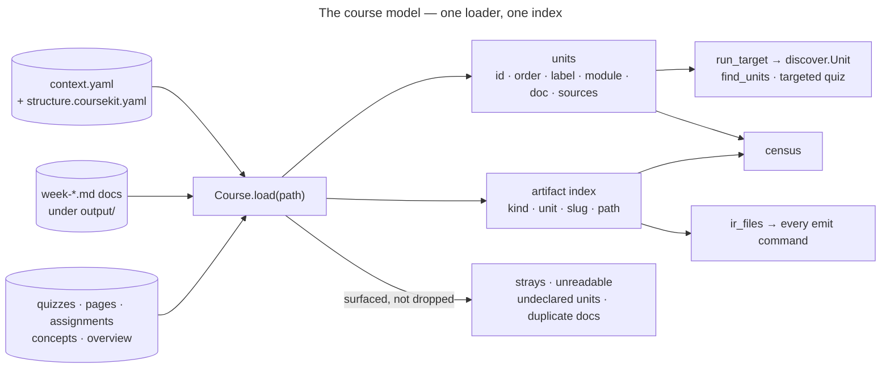
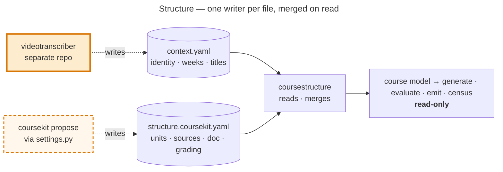
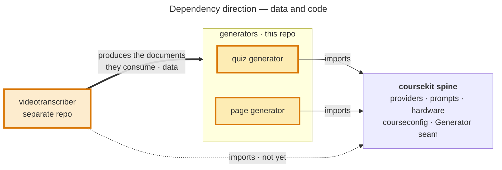

  # Toolkit architecture

Source of truth for the structural diagrams. Kept in `agent/` alongside the other tracked references.
Presented version (republished 30 Oct 2026 from this file): <https://claude.ai/code/artifact/e0d099ed-016c-4911-a75d-7805d5dbffe0>

Verified 30 October 2026 against `main`; every diagram render-checked with mermaid-cli 12.
The 30 Oct pass adds **[the course model](#the-course-model--one-loader-one-index)** (CORE-2: one loader, units with their own identity and stored order, one artifact index that the census, the emitters, and discovery all read), the **CORE-1 spine** (`outcomes` · `schemas` · `settings`, with `coursekit check` and `coursekit config`), the **census**, **assignments** as a third IR, and the built **proposer** (`coursekit propose`).
The 31 July pass (after 27 July's CLI subcommands + `emit course`) added the **analyze** phase (a per-week concept map), the **output-worth evaluator** (facticity · pedagogy · concept-delivery cold reads), and the targeted **fix** loop that regenerates flagged items in place.
The 18 Aug pass adds **[the adapter architecture](#the-adapter-architecture--ingeststructure--ir--generation)** — the three-layer ingest/structure · IR · generation model, the one-writer-per-file rule, and the declared course-structure IR (FLOW-7 Phase 1: `coursestructure.py` + manifest-driven discovery).
The videotranscriber (separate repo at `~/video_transcription`, last commit 18 Aug 2026) still imports nothing from coursekit; only its rows in the [spine table](#dependency-direction) were re-checked in this pass.
The test count lives only in `README.md`, where a meta-test (`tests/test_docs_facts.py`) keeps it honest — it is deliberately not repeated here, because a number stated in two places rots in one of them.

## Three views

Three stories, three diagrams. First the **system in four layers** — who provides what, where the files live, what coursekit actually *is*, and where the output goes (read this one first).
Then **what happens inside coursekit** (the pipeline waist).
Module-level dependencies are the third view, [below](#dependency-direction).

Amber marks a model call: an LLM, or the transcriber's speech model; the dashed outline is `propose --model`, and `ingest --raw` skips ingest's model pass.
The [dependency diagram](#dependency-direction) is the one exception to the arrows: there a thick arrow is data, a solid one a code import, and a dotted one an import that does not exist yet.

### The system, in four layers

Every cylinder marked ② is a plain file in the course folder; every box marked ③ is a coursekit command.

The pieces fall into four layers.
The two things this makes explicit — because the old diagram hid them — are that **`.vtconfig/` is just local files in the course's own folder, created by the tools but freely hand-editable by faculty**, and that **coursekit is a set of programs that *drive* an LLM (local or hosted), not a model itself**.

**① What faculty provides.** The raw material for a week: a lecture video, or readings / PDFs / slides (`.docx`, `.odt`), or — for a course already living in Canvas — a prior course export.
Nothing here is coursekit-specific; it is what the instructor already has.

**② The course folder on disk.** A plain local directory — the course's own folder, marked by a `.vtconfig/` subfolder — holding two kinds of file:

- **the `.vtconfig/` reference:** `context.yaml` (course · weeks · modules) and the per-tool config (`quiz.yaml`, `page.yaml`, `style.yaml`, the per-week supplements, prompt overrides). The tools create these, but they are **faculty-editable** — a professor changes a theme, tunes a prompt, adds a supplement link, or fixes a week title by hand in an ordinary text editor. It is a *local reference coursekit both writes and reads*, not a hidden store.
- **the generated files:** `week-N.md` (the unit's text), the `bank.json` / `page.json` / `assignment.json` IR, the emitted artifacts (`.gift`, QTI `.zip`, `.html`, `.imscc`), and the census (`census.json` + `census.md`).

Everything is plain, versionable files in the course folder — never a database. coursekit **writes** here (week text, IR, artifacts) and **reads** here (config); the transcriber writes here too (`context.yaml`, `week-N.md`).
That file boundary is why the two tools stay separate repos with disjoint runtimes — the transcriber keeps `mlx-whisper` and its Apple-Silicon stack; coursekit stays pydantic + stdlib — and neither imports the other.

**③ coursekit — a set of programs.** Four phases run locally: **ingest** (documents → `week-N.md`), **analyze** (week text + the transcriber's `knowledge.json` → the per-week concept map), **generate** (week text → `bank.json`/`page.json`), **emit** (IR → Canvas files).
Two more verbs sit alongside them as the *output-worth* layer: **evaluate** (cold-read the committed IR for correctness, form, and concept-delivery) and **fix** (regenerate each flagged item in place).
Four more need no model: **propose** drafts the declared structure, grading groups, and expectations for the faculty to edit; **census** inventories what exists for every unit (presence, not quality); **check** validates every settings file; **config** reads and writes one setting.
Of the phases, all except `emit` — and ingest's optional shaping pass — **call an LLM, either one you host locally (LM Studio by default) or a hosted API.** coursekit holds no model of its own; it drives whichever provider is configured, which is what lets the whole thing run offline when the LLM is local. (The transcriber is the *media→text* front door; ingest is the *document→text* one — two ways onto the same folder.)

**④ Delivery — Canvas.** The emitted artifacts import into Canvas (a QTI `.zip`, or an `.imscc` course package).
Canvas is a **sink**.
The one loop back is optional and one-time: a *prior* Canvas export can seed `context.yaml` with real module and week titles — a file read, not a live coupling, and `context.yaml` builds fine from a filesystem scan alone.

### Inside coursekit — the pipeline (the waist)

This opens up layer ③ of the diagram above: each `coursekit …` box there is a labelled boundary here, the IR and packages cylinders split into their actual files, the transcriber reappears as an input, and the LLM shows only as amber highlighting.
Each labelled boundary is one `coursekit` command and what runs inside it; the files sit outside the boundaries because they live in the course folder, where the next command picks them up.
`check` and `config` are left out — they validate and set `.vtconfig/` settings through `settings.py`, and touch nothing in this flow.

**The waist.** Each artifact family has one canonical IR — quizzes converge on `bank.json`, pages on `page.json`, assignments on `assignment.json` — and every emitter reads only its IR (qti from `bank.json`; html/cc from `page.json`; the assignment source from `assignment.json`).
GIFT is the exception: `bank.finalize` writes `bank.gift` and `quiz_<seed>.gift` from the in-memory bank at the same moment it writes `bank.json`, so it is regenerated by a run or a `fix`, never re-emitted from the JSON (`emit gift` is parked as SHIP-8).
The standalone `.html` is likewise first written at generation, beside `page.json`, and `emit html` re-renders it.
Emitters find those files through the course model's index (`course.ir_files`), never by walking the folder.
Adding a platform costs one emitter, not one converter per input, and re-emitting needs no model: `emit qti`, `emit html`, `emit cc`, `emit assignments`, and `emit course` rebuild from the committed JSON.
`emit course` (`emit/cartridge.py`) sits one level up — it assembles all three IRs into one Common Cartridge of week modules, via a `CartridgeSource` per content type (pages, quizzes, assignments; discussions next), so a new content type is one source, not a new assembler.
It reuses the standalone emitters rather than formatting anything itself: a quiz's questions are `qti.emit_assessment`'s XML (only the packaging differs), a page is `cc.render_page`'s HTML (byte-identical to the pages-only `.imscc`), and an assignment's body goes through the same `render_body`.
`emit assignments` is the same assembler with only the assignment source.
So the course `.imscc` is the whole course in one import, and the QTI `.zip`, the pages `.imscc`, and the assignments `.imscc` are the alternative of importing one type at a time.
A Canvas **API** emitter is the gated third delivery path — it will read the same IRs, so it is one more emitter, not a new pipeline.

**The one seam above the waist** — `generate/base.py` — is what the driver speaks: `pipeline.loop` knows only `reset · tools · run_tool_calls · is_finalized · nudge · result`, nothing about quizzes or pages.
Three generators share the driver, at two depths.
The quiz generator and the monolithic teaching page run through `run_unit` (a targeted quiz enters `run_unit` straight from `Course.run_target`).
The assignment generator calls `loop` directly with its own tool set, one assignment per unit from `find_units`.
Pages pass through a dispatcher first (`generate/page/build.py`): only a monolithic teaching page uses the seam; a decomposed teaching page and the glossary run their own per-section tool loop, and overview and recap pages are built from the concept map with no model.

### The output-worth layer — analyze, evaluate, fix

Beyond generation, coursekit **understands, measures, and repairs** its own output — the layer the incumbents' generators don't have.

- **analyze** (`generate/page/concept_map.py` + `consolidate.py`) builds a per-week **concept map** — the teaching concepts, their nested knowledge components, and the one enduring understanding — from the transcriber's `knowledge.json` when present, or the week text when not (same schema, swappable producer). It lands in `.vtconfig/concepts/week-N.yaml` (faculty-editable) and is read by the page generator (as an un-skippable teaching checklist) and by the evaluator (a fixed list to score against, rather than one re-derived each read).
- **evaluate** is the *output-worth* gate — three cold reads over the committed IR, in a fresh conversation per item so it is not the generator grading itself: **facticity** (is each item correct?), **pedagogy** (does the page scan / signal / engage?), and **concept-delivery** (does it teach each concept?). Report-only.
- **fix** closes the loop (`generate/quiz/fix.py`, `generate/page/fix.py`): for each flagged quiz variant or page block it hands the model the material, the flawed item, and the reviewer's concern, and takes a correction committed through the SAME tool with the SAME id — overwriting in place via `bank.load` / `page.load` — then cold-reads the fix to confirm it now passes.

Evaluate and fix read the same IR the emitters do, so the whole flow is **generate → audit → repair → emit**, and only `emit` needs no model.

## The course model — one loader, one index

`coursekit/course.py` (CORE-2, [design](core-2-design.md)) is the course loaded once, by the only walker of generated files.
Everything that asks "which units are there?" or "which artifacts exist?" asks it, so the answers can no longer drift between consumers — which is how the census and the cartridge once resolved grading groups differently.

- **A unit is the course's teaching block, not a week.**
  It has its own `id` (`"3"` for a numbered unit, the declared key otherwise), an `order`, and a display `label` that is never parsed.
- **Order is stored, not computed.**
  Once coursekit's overlay declares units, their order is the overlay's (the file a GUI will reorder); until then units sort by number.
  `context.yaml`'s listing is the transcriber's scan order, not a choice.
- **One ownership rule.**
  An artifact belongs to the unit its own `week_ref` names, else its folder's leading unit (`week-3-essay` → `"3"`), else course scope — so moving an artifact is one field, not a rename.
- **One layout.**
  Artifacts live at `<kind>/<slug>/<ir>.json`; an IR file anywhere else is a stray — warned about, never packaged.
- **Read-only.**
  Every change (a setting, the structure, an artifact's unit) goes through `coursekit/settings.py`, and the course is loaded again — the same path a GUI will take.
- **Two `Unit` classes until CORE-5.**
  `course.Unit` is what the course *is*; `discover.Unit` is one generation run over a unit (it carries `output_dir`).
  `Course.run_target` is the only place the second is built from the first.

## The adapter architecture — ingest/structure · IR · generation

The four-layer view above is *where files live*; this is *who does what to the IR* — the conceptual layering that decides where a new capability belongs.
Three layers over one shared IR:

1. **Ingest / structure adapters.** Turn raw materials into the IR, distinguished by input *modality*, not concept. The **videotranscriber** (media → text; heavy Apple-Silicon stack, its own repo) and **`coursekit/ingest`** (documents → `week-N.md`) are the two built adapters; the **structure proposer** (`coursekit propose`, FLOW-7) is a third — it reads a messy folder tree and *declares* its structure. Multiple entry points, all producing the same IR; they are **peers, not a sequence**.
2. **The IR.** `context.yaml` + coursekit's overlay (declared structure), `week-N.md` (text), the concept map, and the canonical `bank.json` / `page.json` / `assignment.json`. The convergence point, loaded as one [course model](#the-course-model--one-loader-one-index).
3. **Generation** (`generate` · `evaluate` · `emit`) — **read-only on the IR**, never writes structure.

**The rule that keeps the modularity: one writer per file, composed on read.**
Two programs must never write one file — a YAML rewrite reserialises the whole file, so even disjoint keys race and clobber each other's comments and formatting.
So each adapter writes only its **own** file, and the reader (`coursestructure` over `courseconfig`) merges them into one effective structure at load time:

Precedence is defined: `context.yaml` (the transcriber's) owns *identity* — which weeks exist, their titles; coursekit's own `structure.coursekit.yaml` *adds* typed sources, a `doc` pointer, grading groups, and expectations, and its listing of units is the stored unit order.
This is the pattern the project already uses for **shipped prompts + `.vtconfig/prompts` overrides** and **base domain + course `domain.md`** — structure just joins them.
FLOW-7 Phase 1 (built) is the *reader* half — `coursestructure.py` composes the declared structure, and the course model builds units from it when present (so a unit doc can be named anything, not only `week-N.md`), else from the docs on disk.
The *writer* half — the proposer (`coursekit propose`, writing `structure.coursekit.yaml` through `settings.py`, never over a faculty-edited draft without `--force`) — is Phase 2; Phase 3 then pointed `ingest` (grouping) and targeted quizzes (`--source` placement) at the declared structure too, so the manifest is authoritative end-to-end, with filename inference the fallback when nothing is declared.

**The proposer is one station, not three.**
Its job is **input-structure analysis** — read the real materials, declare what exists. Descriptive, grounded in the faculty's own files, low-risk.
Two adjacent temptations are *separate* stations, deliberately not folded in: **output-structure proposal** (what the course *should* contain by pedagogical best practice) is a *prescriptive* course-design advisor (CRSE), grounded in best practice + domain rather than the file tree; **sequencing / pacing** across the term is a course-level planner (STRC).
They chain — analyse inputs → propose output → sequence — but the chain is the *pipeline's* job, not one module's; fusing them would put a descriptive reader and a prescriptive designer behind one interface at one authority level, which is how a tool starts inventing structure and calling it analysis.
Presented companion diagram: <https://claude.ai/code/artifact/74b690a9-4e17-46f4-bc42-c51a55cd555c>.

## Finding the course folder

Layer ② is located, not configured: coursekit **walks up from its input** to find the `.vtconfig/` marker (the way git finds `.git`), then loads the [course model](#the-course-model--one-loader-one-index) from that root.
Structure is **declared when present, inferred when not** (FLOW-7): declared units come from `context.yaml` composed with coursekit's overlay — a unit doc named anything, sources typed by kind — and without a declaration the units are the `week-*.md` docs on disk.
A path below the root filters rather than re-roots: `find_units` and every emit command take the units or artifacts under the folder they were given, and a single file is itself.
It **degrades gracefully** — no `.vtconfig/` at all means the given folder is the course, so a loose `week-3.md` still works.
(`.vtconfig/` is the transcriber-era name; a rename to something tool-neutral is noted in the backlog.)

## Dependency direction

**Two kinds of arrow, because there are two kinds of dependency** — the earlier version showed only the code one, which made the transcriber look barely connected when in fact everything downstream starts with its output.

- **Data (thick).** The transcriber produces the `week-N.md` documents the generators turn into artifacts — the generators are *downstream* of it. The coupling is through the course directory, not an import (any markdown works; the transcriber is just where the documents come from), which is exactly why they can be separate repos.
- **Code (thin).** Both generators import the coursekit spine through the one `Generator` seam (`generate/base.py`): the driver (`run_unit`/`run_course`/`loop`) knows nothing about quizzes or pages, so the page generator reused it untouched. Quiz = `bank.json` → GIFT/QTI; page = `page.json` → HTML, supplements merged at render.

No cycle on either axis.
The transcriber does **not** import the spine yet — same capabilities, its own copies — and that dashed edge is the migration debt, which is measurable:

| Concern | videotranscriber | coursekit | Status |
| --- | --- | --- | --- |
| Provider | `vt_provider.py` (~700 ln) — LM Studio, Ollama, Anthropic, OpenAI; `classify_error`, `discover_loaded`, `unload_all`, vision capability | `providers/` (~230 ln, whole package) — OpenAI-compatible only, **but tool-calling** | **Diverged, complementary** |
| Prompts | `vt_prompts.py` (~400 ln) — same resolution, plus interactive authoring/editing | `prompts.py` (~120 ln) — same mechanism, raises instead of `sys.exit` | Mechanism matches |
| RAM check | `vt_common.py` — two safety factors (0.7 available / 0.35 total), `recommend_model` | `hardware.py` — 0.7 only, plus `loaded_model_keys()` via `lms ps` | **Diverged copies** |
| Project root + config | `find_project_root()`, `find_context_file`/`find_config_file`, week-key parsing — spread across `vt_common.py` | `courseconfig.py` (~290 ln) — all of it in one spine module; validated writes in `settings.py` | **Unified in coursekit; transcriber pending** |

The RAM row is the cautionary one: each copy has grown a capability the other lacks.
`recommend_model` only exists in the transcriber; `loaded_model_keys` (already-loaded models fit by definition) only exists in coursekit.
That is the copy-paste rot the spine was created to stop, and it is already real.

**Merging the providers means the union, not a pick.** The transcriber's has breadth (four vendors, error classification, model lifecycle); coursekit's has the tool-calling contract the transcriber never needed.
Neither is a superset.
Anthropic support in particular is *already written* in `vt_provider.py` for prose — extending it to `tool_use` is a smaller job than starting cold.

## The config gap — closed

Three defects, one root cause: `discover.py` parsed config as a side effect of finding weeks, so nothing was looked for that discovery didn't already need.
`courseconfig.py` (a spine module below discovery) fixed all three.

**The design turn: per-tool config files are separate.** `context.yaml` is shared course structure; each tool's *technical* settings are private to it, because the tools do different jobs.

| File | Owner | Read by |
| --- | --- | --- |
| `context.yaml` | authored by the transcriber (`vt_context.py`) | **both** — shared course facts |
| `config.yaml` | the transcriber | the transcriber only |
| `quiz.yaml` · `page.yaml` · `style.yaml` · `structure.coursekit.yaml` · … | coursekit | coursekit only |

`courseconfig` is the shared *mechanism* — `find_root`, read a yaml file by name, `week_key` normalisation, `load()` (absent files degrade to `{}`; a present but broken one raises a `CoursekitError`).
Each tool owns its *file*.
coursekit's own files are schema-checked on read (`schemas.py` — unknown keys rejected with a did-you-mean) and written only through `settings.py` (validate, then an atomic replace); `coursekit check` validates them all, and `context.yaml` is never written.

What that closed:

- ✅ **Prompt override reachable from the CLI.** `run_unit` passes `project_root=unit.course_root`, so a course's `.vtconfig/prompts/quiz/*.md` override applies. (Was shipped but unwired; mutation-tested.)
- ✅ **Prompts nameable per course.** `quiz.yaml`'s `system_prompt:` / `task_prompt:` keys select a named prompt — coursekit's equivalent of the transcriber's `pedagogy_prompt:` etc. The fallback is caller-supplied (`default="system"`), because coursekit's prompts are `system.md`/`task.md`, not `default.md` — a wrong default would silently request a missing file.
- ✅ **Model per course.** `quiz.yaml`'s `model:` fills in when `MODEL_NAME` is unset.
- ✅ **The duplicated logic is gone.** `discover._find_course_root`, `_load_vtconfig`, `_week_number`, and `pipeline._week_key` all deleted; `discover.py` is 29 lines shorter.

**Slug convention — deliberately *not* changed.** The transcriber writes `output/week 3/` (space), coursekit writes `quizzes/week-3/` (hyphen).
Centralising `week_key` is the whole fix: matching is uniform now, and the two trees never collide.
Changing any *on-disk* path would orphan the CC101 quizzes already emitted, so the paths stay as they are; CORE-5 renames the code's `week_*` names, not the folders.

## Order of operations

Unchanged trigger for the rename (generator #2, not a date), but sharpened:

1. ✅ **Wire the prompt override** — done.
2. ✅ **`courseconfig`, at spine level** — done; the spine (providers · prompts · hardware · courseconfig) is complete.
3. ✅ **The rename** (quizbot → coursekit) — done, one isolated commit, into the package layout above.
4. ✅ **Generator #2 (pages)** — done: the `Generator` seam + `page.json` IR + Jinja renderer + standalone-HTML emitter + a per-week supplements file for instructor links + the **Common Cartridge page emitter** (`emit/cc.py`, `--to-cc`) — one `.imscc` of `type="webcontent"` wiki pages that imports as **Pages** (the `course_settings/canvas_export.txt` marker flips Canvas into its own importer; without it webcontent lands in Files) and places them in one module via `course_settings/module_meta.xml` + the manifest's `<organizations>` tree. Never ships `course_settings.xml`, so it can't mutate the target course. Ground-truthed against the CC101 export; the Pages/modules import is **confirmed in situ**, styled body surviving Canvas's sanitizer.
5. ✅ **The design system** — themes as full identities (bauhaus · terminal · plotter · studio) resolved at render time, a Canvas CSS allowlist + WCAG guardrails, and section roles where design meets pedagogy (recap component, glossary "Key Terms" frame). See `docs/design.md`.
6. ✅ **Document ingest** (`coursekit/ingest/`) — PDF/pptx/docx/odt/txt/md → `week-N.md`, so non-video courses work; `--raw` stays fully offline. coursekit's own front door onto the bus (View 1).
7. ✅ **The whole-course cartridge + CLI shape** — `emit course` assembles pages *and* quizzes into one `.imscc` of week modules via a `CartridgeSource` per content type (extensible to discussions/ assignments); the CLI became phase subcommands (`ingest` / `generate` / `emit`) under a `coursekit` command. Import **confirmed in situ**.
8. ✅ **The output-worth evaluator** — three cold-read checks (facticity · pedagogy · concept-delivery) over the committed IR, calibrated on synthetic sets and wired into `evaluate` / `evaluate --all`.
9. ✅ **The analyze phase + concept map** — per-week `.vtconfig/concepts/week-N.yaml`, from the transcriber's `knowledge.json` or the week text, grounding page generation and evaluation.
10. ✅ **The targeted fix loop** — `fix` regenerates each flagged quiz variant / page block in place and verifies (`bank.load` / `page.load` adopt a finished artifact for in-place edit).
11. ✅ **Assignments** — the third IR (`assignment.json`), a generator with its own mode, and an `AssignmentSource` in the shared cartridge; Canvas import confirmed with a grading rubric attached.
12. ✅ **The census** — `coursekit census`: an offline inventory of every unit's materials and artifacts, with gaps against declared and modal expectations.
13. ✅ **The CORE-1 spine** — `outcomes` (one error type with a stable code, warnings as notices, no prints in library code), `schemas` + `coursekit check`, `settings` + `coursekit config`, and required inputs (a switched-on feature produces its artifact or records why not).
14. ✅ **The course model** (CORE-2) — see [above](#the-course-model--one-loader-one-index).
15. **Migrate the transcriber onto the spine** — providers first, taking the union of capabilities.
16. **Canvas API emitter stays gated** on the local Canvas. File emitters remain first-class.

## Not yet closed

- **The transcriber still carries its own copies** of provider, prompts, RAM check, and project-root logic (the diverged rows above). `courseconfig` is the surface it *can* adopt, but the adoption is its own increment in that repo — this side only built the target.
- **Interactive prompt authoring** (`_author_new_prompt` / `_edit_existing_prompt`) lives only in `vt_prompts.py`.
  Persisting a choice back to config is no longer deferred on this side: `settings.py` writes coursekit's own files (never `context.yaml`).
- **Evaluate and fix still find some artifacts their own way.**
  They get their units from the model, but then look beside each run's folder: pages glob a unit's `<slug>-*` siblings, quizzes glob `quizzes/*/bank.json` for targeted quizzes, and `ingest/propose_grading.py` checks for quizzes and assignments directly.
  Moving them onto the artifact index was a CORE-2 non-goal and is the next walker cleanup.
- **The code still says `week`** (`week_slug`, `week_num`, `discover.Unit`) where the model says *unit*; CORE-5 renames it once its readers have moved.
- **The census does not count overview pages yet**, though the model indexes them — a visible output change, kept out of the byte-identical CORE-2 steps.
