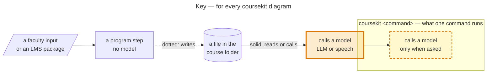
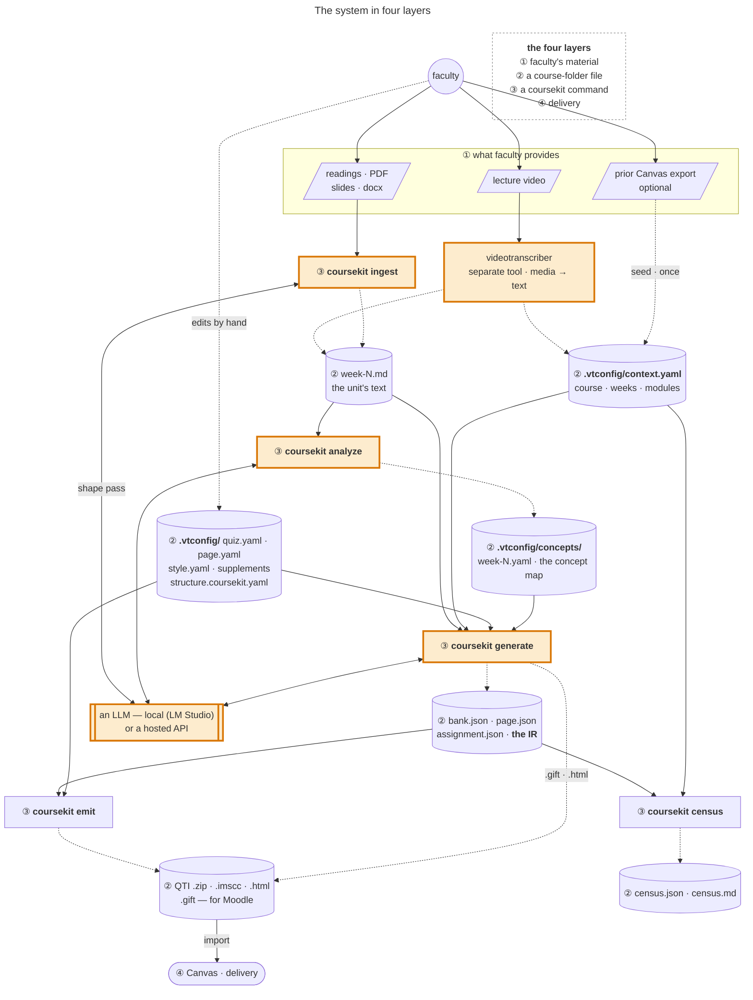
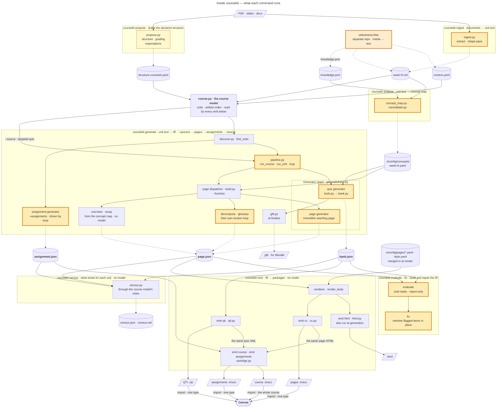

# How coursekit works

How a course's own material becomes Canvas- and Moodle-ready quizzes, pages, and assignments: who provides what, which files live in the course folder, what each `coursekit` command reads and writes, and where a model is involved.
For every command's flags see the [command reference](commands.md); for the internals (the course model, the generator seam, the shared spine) see [agent/architecture.md](../agent/architecture.md).
Verified 30 October 2026 against `main`; every diagram is render-checked with mermaid-cli.

## Reading the diagrams

The key below holds for every coursekit diagram, here and in [agent/architecture.md](../agent/architecture.md).

Amber marks a model call: an LLM, or the transcriber's speech model; the dashed outline is `propose --model`, and `ingest --raw` skips ingest's model pass.

## The system in four layers

Every cylinder marked ② is a plain file in the course folder; every box marked ③ is a coursekit command.

The pieces fall into four layers.
Two things are worth taking from it: **`.vtconfig/` is just local files in the course's own folder, created by the tools but freely hand-editable by faculty**, and that **coursekit is a set of programs that *drive* an LLM (local or hosted), not a model itself**.

**① What faculty provides.** The raw material for a week: a lecture video, or readings / PDFs / slides (`.docx`, `.odt`), or — for a course already living in Canvas — a prior course export.
Nothing here is coursekit-specific; it is what the instructor already has.

**② The course folder on disk.** A plain local directory — the course's own folder, marked by a `.vtconfig/` subfolder — holding two kinds of file:

- **the `.vtconfig/` reference:** `context.yaml` (course · weeks · modules) and the per-tool config (`quiz.yaml`, `page.yaml`, `style.yaml`, the per-week supplements, prompt overrides). The tools create these, but they are **faculty-editable** — a professor changes a theme, tunes a prompt, adds a supplement link, or fixes a week title by hand in an ordinary text editor. It is a *local reference coursekit both writes and reads*, not a hidden store.
- **the generated files:** `week-N.md` (the unit's text), the `bank.json` / `page.json` / `assignment.json` IR, the emitted artifacts (`.gift`, QTI `.zip`, `.html`, `.imscc`), and the census (`census.json` + `census.md`).

Everything is plain, versionable files in the course folder — never a database. coursekit **writes** here (week text, IR, artifacts) and **reads** here (config); the transcriber writes here too (`context.yaml`, `week-N.md`).
That file boundary is why the two tools stay separate repos with disjoint runtimes — the transcriber keeps `mlx-whisper` and its Apple-Silicon stack; coursekit stays pydantic + stdlib — and neither imports the other.

**③ coursekit — a set of programs.** Four phases run locally: **ingest** (documents → `week-N.md`), **analyze** (week text + the transcriber's `knowledge.json` → the per-week concept map), **generate** (week text → `bank.json`/`page.json`), **emit** (IR → Canvas files).
Two more verbs sit alongside them as the *output-worth* layer: **evaluate** (cold-read the committed IR for correctness, form, and concept-delivery) and **fix** (regenerate each flagged item in place).
Four more need no model: **propose** drafts the declared structure, grading groups, and expectations for the faculty to edit; **census** inventories what exists for every unit (presence, not quality); **check** validates every settings file; **config** reads and writes one setting.
Of the phases, all except `emit` — and ingest's optional shaping pass — **call an LLM, either one you host locally (LM Studio by default) or a hosted API.** coursekit holds no model of its own; it drives whichever provider is configured, which is what lets the whole thing run offline when the LLM is local. (The transcriber is the *media→text* front door; ingest is the *document→text* one — two ways onto the same folder.)

**④ Delivery — Canvas.** The emitted artifacts import into Canvas (a QTI `.zip`, or an `.imscc` course package).
Canvas is a **sink**.
The one loop back is optional and one-time: a *prior* Canvas export can seed `context.yaml` with real module and week titles — a file read, not a live coupling, and `context.yaml` builds fine from a filesystem scan alone.

## Inside coursekit — what each command runs

This opens up layer ③ of the diagram above: each `coursekit …` box there is a labelled boundary here, the IR and packages cylinders split into their actual files, the transcriber reappears as an input, and the LLM shows only as amber highlighting.
Each labelled boundary is one `coursekit` command and what runs inside it; the files sit outside the boundaries because they live in the course folder, where the next command picks them up.
`check` and `config` are left out — they validate and set `.vtconfig/` settings through `settings.py`, and touch nothing in this flow.

**The waist.** Each artifact family has one canonical IR — quizzes converge on `bank.json`, pages on `page.json`, assignments on `assignment.json` — and every emitter reads only its IR (qti from `bank.json`; html/cc from `page.json`; the assignment source from `assignment.json`).
GIFT is the exception: `bank.finalize` writes `bank.gift` and `quiz_<seed>.gift` from the in-memory bank at the same moment it writes `bank.json`, so it is regenerated by a run or a `fix`, never re-emitted from the JSON (an `emit gift` that rebuilds it from `bank.json` is planned).
The standalone `.html` is likewise first written at generation, beside `page.json`, and `emit html` re-renders it.
Emitters find those files through the course model's index (`course.ir_files`), never by walking the folder.
Adding a platform costs one emitter, not one converter per input, and re-emitting needs no model: `emit qti`, `emit html`, `emit cc`, `emit assignments`, and `emit course` rebuild from the committed JSON.
`emit course` (`emit/cartridge.py`) sits one level up — it assembles all three IRs into one Common Cartridge of week modules, via a `CartridgeSource` per content type (pages, quizzes, assignments; discussions next), so a new content type is one source, not a new assembler.
It reuses the standalone emitters rather than formatting anything itself: a quiz's questions are `qti.emit_assessment`'s XML (only the packaging differs), a page is `cc.render_page`'s HTML (byte-identical to the pages-only `.imscc`), and an assignment's body goes through the same `render_body`.
`emit assignments` is the same assembler with only the assignment source.
So the course `.imscc` is the whole course in one import, and the QTI `.zip`, the pages `.imscc`, and the assignments `.imscc` are the alternative of importing one type at a time.
A Canvas **API** emitter is the gated third delivery path — it will read the same IRs, so it is one more emitter, not a new pipeline.
